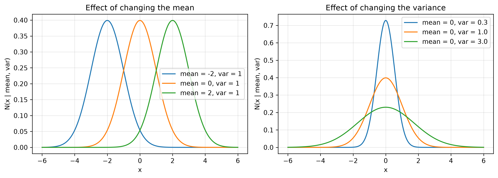

# Experiment 1: Gaussian Distribution Function

> **File:** `exp1.py`  |  **Tools:** Python 3.13, NumPy and Matplotlib, MacOS

## 🎯 Aim

Write a Python function to evaluate the Gaussian (normal) distribution N(μ, σ²) and plot the curve for different values of the mean and the variance.

## 📘 Theory

The Gaussian distribution is the familiar bell-shaped probability density that is completely described by two numbers: the mean μ and the variance σ². Many natural quantities such as heights, measurement errors and sensor noise follow this shape, which is why it appears everywhere in machine learning and computer vision. The density at a point x is given by:

- **Mean (μ)**: decides where the centre of the bell lies on the x-axis, so changing it only slides the curve left or right.
- **Variance (σ²)**: decides how wide the bell is. A small variance gives a tall, narrow curve and a large variance gives a short, wide one.
- **Probability density**: the total area under the curve is always equal to 1.

### 📐 Formulas

$$ N\left(x | \mu , {\sigma }^{2}\right) = \frac{1}{\sqrt{2\pi {\sigma }^{2}}}{e}^{-\frac{{\left(x - \mu \right)}^{2}}{2{\sigma }^{2}}} $$

## 🪜 Algorithm / Steps

1. Import NumPy and Matplotlib.
2. Define the function gaussian_pdf(x, mu, sigma2) using the formula.
3. Create 600 equally spaced values of x between -6 and 6 using linspace().
4. Plot the curve for three means (variance fixed) and for three variances (mean fixed).
5. Check numerically that the area under the N(0, 1) curve is 1.

## 💻 Code

```python
import numpy as np
import matplotlib.pyplot as plt

def gaussian_pdf(x, mu, sigma2):
    coeff = 1.0 / np.sqrt(2.0 * np.pi * sigma2)
    return coeff * np.exp(-((x - mu) ** 2) / (2.0 * sigma2))

x = np.linspace(-6, 6, 600)

fig, ax = plt.subplots(1, 2, figsize=(11, 4))

for mu in [-2, 0, 2]:
    ax[0].plot(x, gaussian_pdf(x, mu, 1.0), label=f"mean = {mu}, var = 1")
ax[0].set_title("Effect of changing the mean")

for var in [0.3, 1.0, 3.0]:
    ax[1].plot(x, gaussian_pdf(x, 0, var), label=f"mean = 0, var = {var}")
ax[1].set_title("Effect of changing the variance")

for a in ax:
    a.set_xlabel("x")
    a.set_ylabel("N(x | mean, var)")
    a.grid(alpha=0.3)
    a.legend()
plt.tight_layout()
plt.show()

print("Peak height for different variances (mean = 0):")
for var in [0.3, 1.0, 3.0]:
    peak = gaussian_pdf(0, 0, var)
    print(f"  variance = {var:<4} -> N(0 | 0, {var}) = {peak:.4f}")
dx = x[1] - x[0]
area = np.sum(gaussian_pdf(x, 0, 1.0)) * dx
print(f"Area under N(0,1) curve = {area:.4f}")
```

## 🖥️ Output

```text
Peak height for different variances (mean = 0):
  variance = 0.3  -> N(0 | 0, 0.3) = 0.7284
  variance = 1.0  -> N(0 | 0, 1.0) = 0.3989
  variance = 3.0  -> N(0 | 0, 3.0) = 0.2303
Area under N(0,1) curve = 1.0000
```

<p align="center"></p>

## ✅ Result

The curve shifted sideways when μ was changed and became narrower or wider when σ² was changed. The peak height equals 1/√(2πσ²), which is 0.3989 for σ² = 1, and the area under N(0, 1) came out as 1.0000.

## 🎤 Viva Questions

**Q. What is the Gaussian (normal) distribution?**  
A. A bell shaped, symmetric probability distribution that is fixed completely by its mean and variance.

**Q. What does the mean do to the curve?**  
A. It moves the whole curve to the left or right; the peak sits at the mean.

**Q. What does the variance do to the curve?**  
A. A larger variance makes the curve wider and lower, a smaller variance makes it narrow and tall.

**Q. What is the area under the whole curve?**  
A. Exactly 1, because it is a probability density.

**Q. What is the 68-95-99.7 rule?**  
A. About 68 %, 95 % and 99.7 % of the values lie within one, two and three standard deviations of the mean.

---
[⬅ Back to index](README.md)
