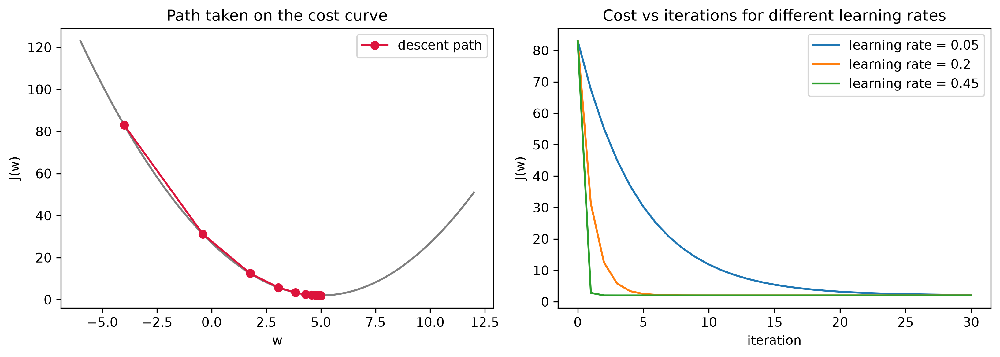

# Experiment 2: Gradient Descent

> **File:** `exp2.py`  |  **Tools:** Python 3.13, NumPy and Matplotlib, MacOS

## 🎯 Aim

Implement the gradient descent algorithm to find the minimum of a function.

## 📘 Theory

Gradient descent is an iterative optimisation method used to minimise a cost function. Starting from an initial guess, the parameter is moved a small step in the direction opposite to the gradient, because the negative gradient points towards the steepest decrease of the function. The update rule for a single parameter w is:

- **Cost function J(w)**: the quantity to be minimised. Here J(w) = (w − 5)² + 2, whose minimum is at w = 5.
- **Gradient**: the slope dJ/dw of the cost at the current point. Near the minimum it becomes almost zero.
- **Learning rate (α)**: the step size. If it is too small convergence is slow, and if it is too large the steps overshoot the minimum.

### 📐 Formulas

$$ {w}_{\text{new}} = {w}_{\text{old}} - \alpha \frac{\partial J\left(w\right)}{\partial w} $$

## 🪜 Algorithm / Steps

1. Define the cost function J(w) and its derivative.
2. Start from w = -4 and choose the learning rate α = 0.2.
3. Repeat the update w = w − α · dJ/dw for 15 iterations and store every value.
4. Print the table of iteration, w, J(w) and gradient.
5. Plot the path on the cost curve and compare three different learning rates.

## 💻 Code

```python
import numpy as np
import matplotlib.pyplot as plt

def cost(w):
    return (w - 5) ** 2 + 2

def grad(w):
    return 2 * (w - 5)

def gradient_descent(w0, lr, steps):
    w = w0
    path = [w]
    for _ in range(steps):
        w = w - lr * grad(w)
        path.append(w)
    return np.array(path)

w_start, lr, steps = -4.0, 0.2, 15
path = gradient_descent(w_start, lr, steps)

print(f"Start = {w_start}, learning rate = {lr}, iterations = {steps}")
print("-" * 44)
print(f"{'Iter':>4} | {'w':>10} | {'J(w)':>10} | {'dJ/dw':>10}")
print("-" * 44)
for i, w in enumerate(path):
    if i % 3 == 0 or i == steps:
        print(f"{i:>4} | {w:>10.4f} | {cost(w):>10.4f} | {grad(w):>10.4f}")
print("-" * 44)
print(f"Minimum reached at w = {path[-1]:.4f}, J(w) = {cost(path[-1]):.4f}")

fig, ax = plt.subplots(1, 2, figsize=(11, 4))
w_axis = np.linspace(-6, 12, 200)
ax[0].plot(w_axis, cost(w_axis), color="gray")
ax[0].plot(path, cost(path), "o-", color="crimson", label="descent path")
ax[0].set_title("Path taken on the cost curve")
ax[0].set_xlabel("w"); ax[0].set_ylabel("J(w)"); ax[0].legend()

for rate in [0.05, 0.2, 0.45]:
    p = gradient_descent(w_start, rate, 30)
    ax[1].plot(cost(p), label=f"learning rate = {rate}")
ax[1].set_title("Cost vs iterations for different learning rates")
ax[1].set_xlabel("iteration"); ax[1].set_ylabel("J(w)"); ax[1].legend()
plt.tight_layout()
plt.show()
```

## 🖥️ Output

```text
Start = -4.0, learning rate = 0.2, iterations = 15
--------------------------------------------
Iter |          w |       J(w) |      dJ/dw
--------------------------------------------
   0 |    -4.0000 |    83.0000 |   -18.0000
   3 |     3.0560 |     5.7791 |    -3.8880
   6 |     4.5801 |     2.1763 |    -0.8398
   9 |     4.9093 |     2.0082 |    -0.1814
  12 |     4.9804 |     2.0004 |    -0.0392
  15 |     4.9958 |     2.0000 |    -0.0085
--------------------------------------------
Minimum reached at w = 4.9958, J(w) = 2.0000
```

<p align="center"></p>

## ✅ Result

Starting from w = −4, the value reached 4.9958 after 15 iterations, which is very close to the true minimum w = 5 where J = 2. The comparison plot shows that a very small rate converges slowly while a moderate rate converges quickly.

## 🎤 Viva Questions

**Q. What is gradient descent?**  
A. An iterative method that moves the parameters in the direction opposite to the gradient to reach a minimum of a function.

**Q. What is the learning rate?**  
A. The size of each step; it is the factor that multiplies the gradient.

**Q. What happens if the learning rate is too large?**  
A. The steps overshoot the minimum and the cost may oscillate or even diverge.

**Q. When does the algorithm stop?**  
A. When the length of the gradient is smaller than a tolerance or a maximum number of steps is reached.

**Q. Why does a convex function help?**  
A. It has a single global minimum, so gradient descent cannot get stuck in a local one.

---
[⬅ Back to index](README.md)
