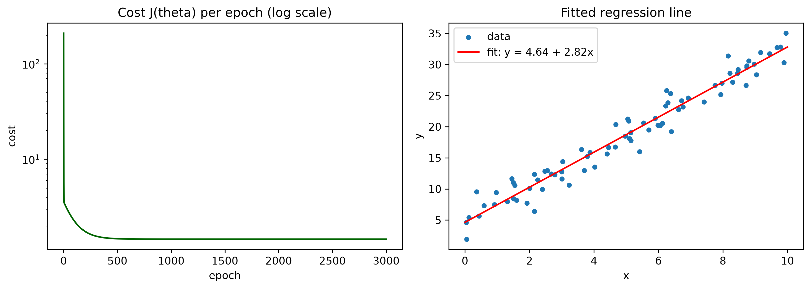

# Experiment 3: Linear Regression using Gradient Descent

> **File:** `exp3.py`  |  **Tools:** Python 3.13, NumPy and Matplotlib, MacOS

## 🎯 Aim

Implement linear regression using gradient descent.

## 📘 Theory

Linear regression is a supervised learning technique that models a continuous output as a straight-line function of the input. For one input feature the hypothesis, the cost function (mean squared error) and the gradient descent update for each parameter are:

- **Bias column**: a column of ones is added to the input so that the intercept θ₀ is learned like any other weight.
- **Mean squared error**: measures the average squared distance between the predictions and the actual values.
- **R² score**: tells how much of the variation in y is explained by the model (1.0 is a perfect fit).
- **Normal equation**: the closed-form solution, used here to verify the answer of gradient descent.

### 📐 Formulas

$$ {h}_{\theta }\left(x\right) = {\theta }_{0} + {\theta }_{1}x $$

$$ J\left(\theta \right) = \frac{1}{2m}\sum_{i = 1}^{m} {\left({h}_{\theta }\left({x}^{\left(i\right)}\right) - {y}^{\left(i\right)}\right)}^{2} $$

$$ {\theta }_{j} := {\theta }_{j} - \frac{\alpha }{m}\sum_{i = 1}^{m} \left({h}_{\theta }\left({x}^{\left(i\right)}\right) - {y}^{\left(i\right)}\right){x}_{j}^{\left(i\right)} $$

## 🪜 Algorithm / Steps

1. Generate 80 noisy data points from the line y = 4 + 3x.
2. Add a column of ones to X and initialise θ with zeros.
3. Run gradient descent for 3000 epochs (α = 0.02) and record the cost in every epoch.
4. Compare θ with the normal-equation solution and calculate the R² score.
5. Plot the cost per epoch and the fitted line over the data.

## 💻 Code

```python
import numpy as np
import matplotlib.pyplot as plt

rng = np.random.default_rng(7)

n = 80
x = rng.uniform(0, 10, n)
y = 4 + 3 * x + rng.normal(0, 2.0, n)

X = np.column_stack([np.ones(n), x])
theta = np.zeros(2)
alpha, epochs = 0.02, 3000
losses = []

for _ in range(epochs):
    error = X @ theta - y
    theta -= alpha * (X.T @ error) / n
    losses.append(np.mean(error ** 2) / 2)

y_hat = X @ theta
ss_res = np.sum((y - y_hat) ** 2)
ss_tot = np.sum((y - y.mean()) ** 2)
r2 = 1 - ss_res / ss_tot

theta_ne = np.linalg.inv(X.T @ X) @ X.T @ y

print(f"Learning rate = {alpha}, epochs = {epochs}")
print(f"Intercept (theta0) by gradient descent : {theta[0]:.4f}")
print(f"Slope     (theta1) by gradient descent : {theta[1]:.4f}")
print(f"Intercept / slope by normal equation   : "
      f"{theta_ne[0]:.4f} / {theta_ne[1]:.4f}")
print(f"Final cost J = {losses[-1]:.4f}")
print(f"R-squared    = {r2:.4f}")

fig, ax = plt.subplots(1, 2, figsize=(11, 4))
ax[0].plot(losses, color="darkgreen")
ax[0].set_yscale("log")
ax[0].set_title("Cost J(theta) per epoch (log scale)")
ax[0].set_xlabel("epoch"); ax[0].set_ylabel("cost")
ax[1].scatter(x, y, s=15, label="data")
xs = np.array([0, 10])
label = f"fit: y = {theta[0]:.2f} + {theta[1]:.2f}x"
ax[1].plot(xs, theta[0] + theta[1] * xs, "r", label=label)
ax[1].set_title("Fitted regression line")
ax[1].set_xlabel("x"); ax[1].set_ylabel("y"); ax[1].legend()
plt.tight_layout()
plt.show()
```

## 🖥️ Output

```text
Learning rate = 0.02, epochs = 3000
Intercept (theta0) by gradient descent : 4.6394
Slope     (theta1) by gradient descent : 2.8178
Intercept / slope by normal equation   : 4.6394 / 2.8178
Final cost J = 1.4527
R-squared    = 0.9580
```

<p align="center"></p>

## ✅ Result

Gradient descent gave θ₀ = 4.6394 and θ₁ = 2.8178, exactly equal to the normal-equation solution, with an R² score of 0.958. The fitted line follows the data points closely.

## 🎤 Viva Questions

**Q. What is the cost function of linear regression?**  
A. Half of the mean squared error between the predictions and the true values.

**Q. Why are the features standardised?**  
A. So that all features have a similar scale and gradient descent converges quickly with one learning rate.

**Q. What is the normal equation?**  
A. A closed form solution of least squares, w = (XᵀX)⁻¹Xᵀy, used here to check gradient descent.

**Q. What does R² show?**  
A. The share of the variation of the target that the model explains.

**Q. What is the role of the bias term?**  
A. It lets the fitted line or plane have a value other than zero when all inputs are zero.

---
[⬅ Back to index](README.md)
