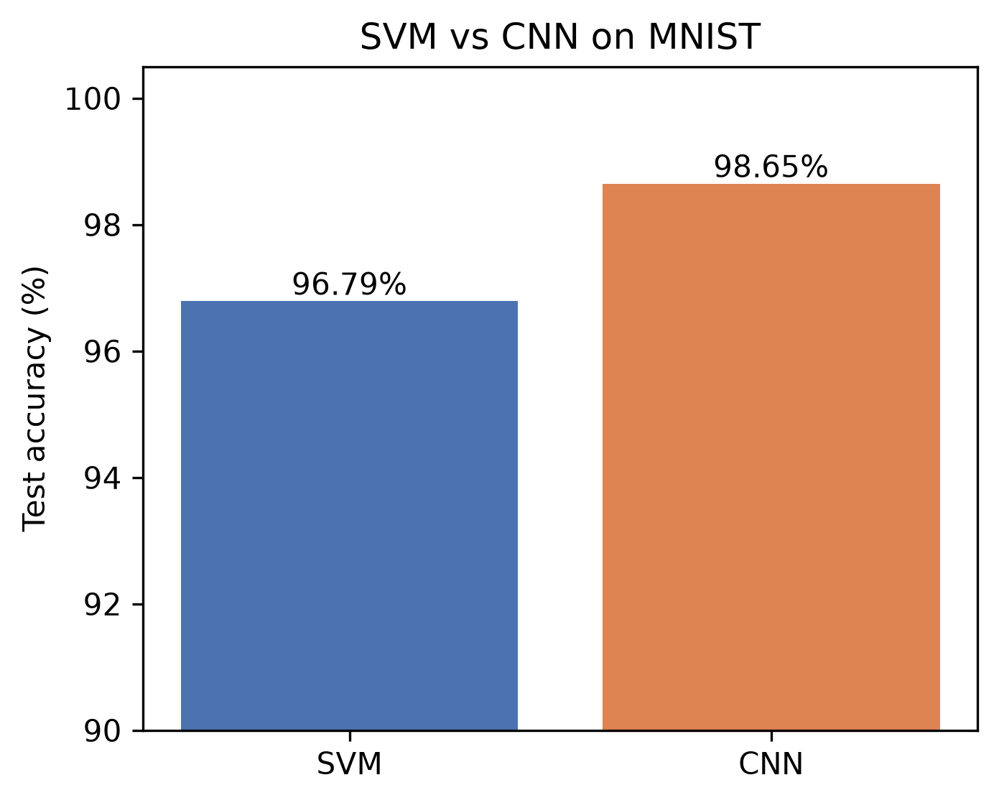

# Experiment 4: Comparison of SVM and CNN

> **File:** `exp4.py`  |  **Tools:** Python 3.13, scikit-learn, TensorFlow (Keras), NumPy and Matplotlib, MacOS

## 🎯 Aim

Compare the classification accuracy of a Support Vector Machine (SVM) and a Convolutional Neural Network (CNN) on handwritten digits.

## 📘 Theory

An SVM is a classical classifier that finds the boundary having the largest margin between classes. With an RBF kernel it can separate data that is not linearly separable, but it works on flattened pixel vectors and ignores the 2-D structure of an image. A CNN learns small filters that slide over the image, so it captures edges, strokes and shapes automatically and usually performs better on images. The SVM decision function is:

- **MNIST**: 60,000 training and 10,000 test images of digits 0 to 9, each 28 × 28 pixels.
- **SVM (RBF kernel)**: trained on the first 10,000 images because an SVM becomes slow on large data.
- **CNN**: two convolution + max-pooling blocks, dropout and a softmax output layer, trained on the full training set.
- **Accuracy**: percentage of test images classified correctly.

### 📐 Formulas

$$ f\left(x\right) = \text{sign}\left(\sum_{i} {\alpha }_{i}{y}_{i}K\left({x}_{i}, x\right) + b\right) $$

## 🪜 Algorithm / Steps

1. Load MNIST and scale the pixel values to the range 0 to 1.
2. Train an SVC (RBF kernel) on 10,000 images and test it on the 10,000 test images.
3. Build the CNN using Keras and train it for 3 epochs on the training set.
4. Evaluate the CNN on the same test images.
5. Compare both accuracies using a bar chart.

## 💻 Code

```python
import time
import numpy as np
import matplotlib.pyplot as plt
import tensorflow as tf
from sklearn.svm import SVC
from sklearn.metrics import accuracy_score

tf.random.set_seed(1)
np.random.seed(1)

(x_tr, y_tr), (x_te, y_te) = tf.keras.datasets.mnist.load_data()
x_tr = x_tr.astype("float32") / 255.0
x_te = x_te.astype("float32") / 255.0
print("Train:", x_tr.shape, " Test:", x_te.shape)

t0 = time.time()
svm = SVC(kernel="rbf", gamma="scale", C=5)
svm.fit(x_tr[:10000].reshape(10000, -1), y_tr[:10000])
svm_acc = accuracy_score(y_te, svm.predict(x_te.reshape(len(x_te), -1)))
svm_time = time.time() - t0
print(f"SVM  accuracy = {svm_acc*100:.2f}%   (time {svm_time:.0f}s)")

cnn = tf.keras.Sequential([
    tf.keras.layers.Input((28, 28, 1)),
    tf.keras.layers.Conv2D(32, 3, activation="relu"),
    tf.keras.layers.MaxPooling2D(),
    tf.keras.layers.Conv2D(64, 3, activation="relu"),
    tf.keras.layers.MaxPooling2D(),
    tf.keras.layers.Flatten(),
    tf.keras.layers.Dropout(0.3),
    tf.keras.layers.Dense(10, activation="softmax"),
])
cnn.compile("adam", "sparse_categorical_crossentropy", metrics=["accuracy"])
t0 = time.time()
cnn.fit(x_tr[..., None], y_tr, epochs=3, batch_size=128,
        validation_split=0.1, verbose=2)
_, cnn_acc = cnn.evaluate(x_te[..., None], y_te, verbose=0)
cnn_time = time.time() - t0
print(f"CNN  accuracy = {cnn_acc*100:.2f}%   (time {cnn_time:.0f}s)")

print("\nSummary")
print(f"  SVM : {svm_acc*100:.2f}%")
print(f"  CNN : {cnn_acc*100:.2f}%")

plt.figure(figsize=(5, 4))
bars = plt.bar(["SVM", "CNN"], [svm_acc * 100, cnn_acc * 100],
               color=["#4c72b0", "#dd8452"])
for b in bars:
    plt.text(b.get_x() + b.get_width() / 2, b.get_height() + 0.1,
             f"{b.get_height():.2f}%", ha="center")
plt.ylim(90, 100.5)
plt.ylabel("Test accuracy (%)")
plt.title("SVM vs CNN on MNIST")
plt.show()
```

## 🖥️ Output

```text
Train: (60000, 28, 28)  Test: (10000, 28, 28)
SVM  accuracy = 96.79%   (time 64s)
Epoch 1/3
422/422 - 6s - 15ms/step - accuracy: 0.9020 - loss: 0.3401 - val_accuracy: 0.9793 - val_loss: 0.0749
Epoch 2/3
422/422 - 8s - 20ms/step - accuracy: 0.9722 - loss: 0.0918 - val_accuracy: 0.9865 - val_loss: 0.0512
Epoch 3/3
422/422 - 7s - 17ms/step - accuracy: 0.9794 - loss: 0.0667 - val_accuracy: 0.9885 - val_loss: 0.0430
CNN  accuracy = 98.65%   (time 22s)

Summary
  SVM : 96.79%
  CNN : 98.65%
```

<p align="center"></p>

## ✅ Result

The SVM reached 96.79% test accuracy and the CNN reached 98.65%. The CNN performed better even with only 3 epochs, because it uses the spatial pattern of the pixels.

## 🎤 Viva Questions

**Q. How does an SVM classify?**  
A. It finds the boundary that separates the classes with the widest margin; a kernel allows curved boundaries.

**Q. What does a convolution layer do?**  
A. It slides small filters over the image to detect local patterns such as edges and strokes.

**Q. What is pooling?**  
A. It keeps the strongest response in a small window, so the map becomes smaller and tolerant to small shifts.

**Q. What does a confusion matrix show?**  
A. How many samples of each true class were predicted as each class; the diagonal is correct.

**Q. Why can a CNN be better than an SVM on images?**  
A. It keeps the image structure and learns its own features, while an SVM sees only a flat list of pixels.

---
[⬅ Back to index](README.md)
