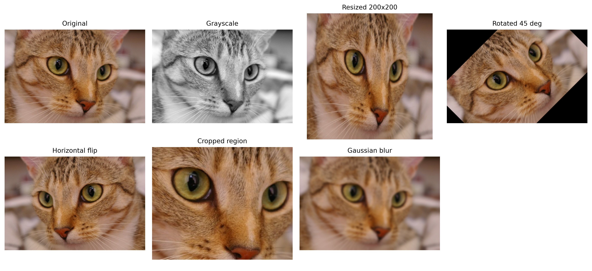

# Experiment 5: Basic Image Handling and Processing

> **File:** `exp5.py`  |  **Tools:** Python 3.13, OpenCV (cv2), NumPy and Matplotlib, MacOS

## 🎯 Aim

Implement basic image handling and processing operations using OpenCV.

## 📘 Theory

A digital image is stored as a matrix of pixel values. A colour image has three channels and a grayscale image has one. OpenCV reads colour images in B-G-R order, so they must be converted to R-G-B before being shown with Matplotlib.

- **Reading and inspecting**: cv2.imread() loads the image and .shape gives its height, width and channels.
- **Grayscale conversion**: reduces the image to a single intensity channel.
- **Resize, rotate and flip**: change the size, orientation and mirror direction of the image.
- **Cropping**: a region is selected by simple array slicing.
- **Gaussian blur**: smooths the image and removes small noise.

## 🪜 Algorithm / Steps

1. Read sample.jpg with cv2.imread() and convert it from BGR to RGB.
2. Print the shape, data type and one pixel value of the image.
3. Convert it to grayscale and resize it to 200 × 200.
4. Rotate it by 45° with getRotationMatrix2D() and warpAffine(), flip it horizontally, crop a region and apply a Gaussian blur.
5. Display all the results together in one figure.

## 💻 Code

```python
import cv2
import numpy as np
import matplotlib.pyplot as plt

img_bgr = cv2.imread("sample.jpg")
if img_bgr is None:
    raise FileNotFoundError("sample.jpg not found")
img = cv2.cvtColor(img_bgr, cv2.COLOR_BGR2RGB)
h, w = img.shape[:2]
print("Image shape  :", img.shape, "(height, width, channels)")
print("Data type    :", img.dtype)
print("Pixel [100,100] (R,G,B):", img[100, 100])

gray    = cv2.cvtColor(img_bgr, cv2.COLOR_BGR2GRAY)
resized = cv2.resize(img, (200, 200))
M       = cv2.getRotationMatrix2D((w // 2, h // 2), 45, 1.0)
rotated = cv2.warpAffine(img, M, (w, h))
flipped = cv2.flip(img, 1)
cropped = img[50:250, 100:350]
blurred = cv2.GaussianBlur(img, (15, 15), 0)

print("Gray shape   :", gray.shape)
print("Resized shape:", resized.shape)
print("Cropped shape:", cropped.shape)

items = [(img, "Original"), (gray, "Grayscale"),
         (resized, "Resized 200x200"),
         (rotated, "Rotated 45 deg"), (flipped, "Horizontal flip"),
         (cropped, "Cropped region"), (blurred, "Gaussian blur")]
fig, axes = plt.subplots(2, 4, figsize=(13, 6))
for ax, (im, title) in zip(axes.ravel(), items):
    ax.imshow(im, cmap="gray" if im.ndim == 2 else None)
    ax.set_title(title, fontsize=10)
    ax.axis("off")
axes.ravel()[-1].axis("off")
plt.tight_layout()
plt.show()
```

## 🖥️ Output

```text
Image shape  : (300, 451, 3) (height, width, channels)
Data type    : uint8
Pixel [100,100] (R,G,B): [164 113  66]
Gray shape   : (300, 451)
Resized shape: (200, 200, 3)
Cropped shape: (200, 250, 3)
```

<p align="center"></p>

## ✅ Result

The image of size 300 × 451 × 3 was successfully read, converted, resized to 200 × 200, rotated by 45°, flipped, cropped to 200 × 250 and blurred.

## 🎤 Viva Questions

**Q. In which order does OpenCV store colours?**  
A. Blue, green, red (BGR), so the image is converted to RGB before showing it with Matplotlib.

**Q. What is a channel?**  
A. One colour plane of the image; a colour image has three, a grey image has one.

**Q. What does Otsu's method do?**  
A. It selects the threshold automatically by minimising the variance inside the two groups of pixels.

**Q. What does histogram equalisation do?**  
A. It spreads the grey levels over the whole range to improve the contrast.

**Q. How does the Canny detector work?**  
A. It smooths the image, finds the gradient and keeps thin edges using a high and a low threshold.

---
[⬅ Back to index](README.md)
