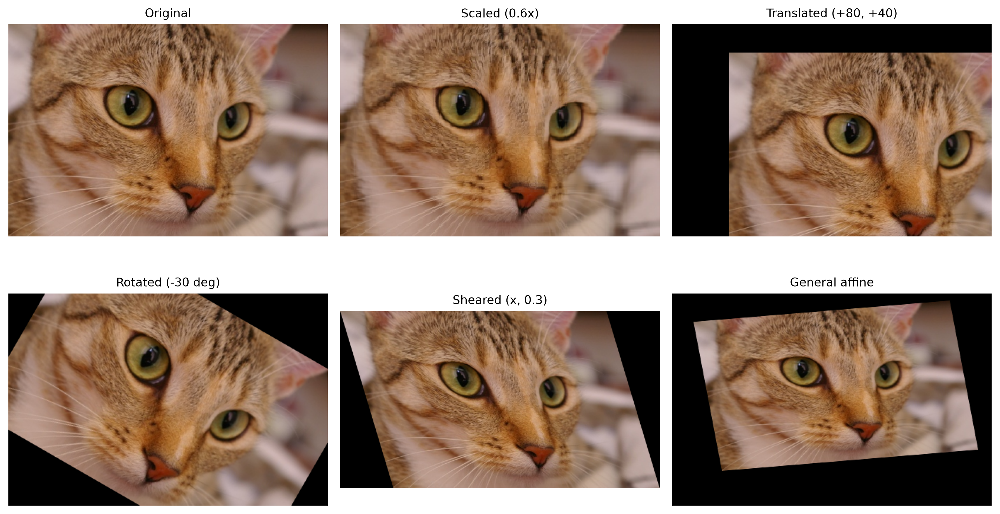

# Experiment 6: Geometric Transformation

> **File:** `exp6.py`  |  **Tools:** Python 3.13, OpenCV (cv2), NumPy and Matplotlib, MacOS

## 🎯 Aim

Implement geometric transformations (scaling, translation, rotation, shear and affine) on an image.

## 📘 Theory

A geometric transformation changes the position of pixels without changing their colour. All the transformations below are affine, which means straight lines remain straight and parallel lines remain parallel. Every affine transform can be written with a 2 × 3 matrix, applied as:

- **Scaling**: changes the size of the image.
- **Translation**: shifts the image along the x and y axes.
- **Rotation**: turns the image about a centre point by a given angle.
- **Shear**: slants the image along one axis.
- **General affine**: obtained from three pairs of corresponding points using cv2.getAffineTransform().

### 📐 Formulas

$$ x' = {a}_{11}x + {a}_{12}y + {t}_{x} $$

$$ y' = {a}_{21}x + {a}_{22}y + {t}_{y} $$

## 🪜 Algorithm / Steps

1. Read the image and convert it to RGB.
2. Scale it to 0.6× with cv2.resize().
3. Build the translation, rotation and shear matrices and apply them with cv2.warpAffine().
4. Compute a general affine matrix from three point pairs and apply it.
5. Print the matrices and show every result in one figure.

## 💻 Code

```python
import cv2
import numpy as np
import matplotlib.pyplot as plt

img = cv2.cvtColor(cv2.imread("sample.jpg"), cv2.COLOR_BGR2RGB)
h, w = img.shape[:2]

scaled = cv2.resize(img, None, fx=0.6, fy=0.6, interpolation=cv2.INTER_AREA)

T = np.float32([[1, 0, 80],
                [0, 1, 40]])
translated = cv2.warpAffine(img, T, (w, h))

R = cv2.getRotationMatrix2D((w / 2, h / 2), -30, 1.0)
rotated = cv2.warpAffine(img, R, (w, h))

S = np.float32([[1, 0.3, 0],
                [0, 1,   0]])
sheared = cv2.warpAffine(img, S, (int(w + 0.3 * h), h))

src = np.float32([[0, 0], [w - 1, 0], [0, h - 1]])
dst = np.float32([[30, 40], [w - 60, 10], [70, h - 50]])
A = cv2.getAffineTransform(src, dst)
affine = cv2.warpAffine(img, A, (w, h))

print("Translation matrix:\n", T)
print("Rotation matrix (-30 deg):\n", np.round(R, 3))
print("Affine matrix from 3 point pairs:\n", np.round(A, 3))
print("Scaled size :", scaled.shape[:2])
print("Sheared size:", sheared.shape[:2])

items = [(img, "Original"), (scaled, "Scaled (0.6x)"),
         (translated, "Translated (+80, +40)"),
         (rotated, "Rotated (-30 deg)"), (sheared, "Sheared (x, 0.3)"),
         (affine, "General affine")]
fig, axes = plt.subplots(2, 3, figsize=(12, 7))
for ax, (im, t) in zip(axes.ravel(), items):
    ax.imshow(im); ax.set_title(t, fontsize=10); ax.axis("off")
plt.tight_layout()
plt.show()
```

## 🖥️ Output

```text
Translation matrix:
 [[ 1.  0. 80.]
 [ 0.  1. 40.]]
Rotation matrix (-30 deg):
 [[  0.866  -0.5   105.211]
 [  0.5     0.866 -92.654]]
Affine matrix from 3 point pairs:
 [[ 0.802  0.134 30.   ]
 [-0.067  0.702 40.   ]]
Scaled size : (180, 271)
Sheared size: (300, 541)
```

<p align="center"></p>

## ✅ Result

The image was scaled to 0.6×, translated by (80, 40) pixels, rotated by −30°, sheared by a factor of 0.3 and finally warped with a general affine matrix. All outputs are shown in the figure.

## 🎤 Viva Questions

**Q. What are homogeneous coordinates?**  
A. The point (x, y) is written as (x, y, 1), so that translation also becomes a matrix multiplication.

**Q. What is an affine transformation?**  
A. A combination of scaling, rotation, shear and translation; parallel lines stay parallel.

**Q. How is a rotation about the centre of the image done?**  
A. Move the centre to the origin, rotate, and move back; the three matrices are multiplied.

**Q. What does the determinant of the matrix tell?**  
A. The factor by which the area of the image changes.

**Q. Does the order of the matrices matter?**  
A. Yes, matrix multiplication is not commutative, so a different order gives a different result.

---
[⬅ Back to index](README.md)
