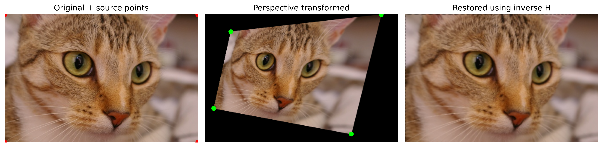

# Experiment 7: Perspective Transformation

> **File:** `exp7.py`  |  **Tools:** Python 3.13, OpenCV (cv2), NumPy and Matplotlib, MacOS

## 🎯 Aim

Implement perspective transformation on an image.

## 📘 Theory

A perspective transformation (homography) maps a plane to another plane as if the camera viewpoint has changed. Unlike an affine transform it does not keep parallel lines parallel, so a rectangle can become a general four-sided shape, which is how a tilted document can be straightened. It is described by a 3 × 3 matrix H acting on homogeneous coordinates, and the final pixel position is found after dividing by the third coordinate:

- **Homography matrix (H)**: a 3 × 3 matrix computed from four point pairs.
- **Source and destination points**: the four corners of the image and the places where they should land.
- **Inverse transform**: applying H⁻¹ brings the image back to its original view.

### 📐 Formulas

$$ \tilde{p}' = H \tilde{p} $$

$$ u = \frac{x'}{w'}, v = \frac{y'}{w'} $$

## 🪜 Algorithm / Steps

1. Read the image and choose its four corners as source points.
2. Choose four new positions as destination points.
3. Compute H using cv2.getPerspectiveTransform().
4. Warp the image using cv2.warpPerspective() and check one corner using H.
5. Apply the inverse of H to recover the original image and display all three images.

## 💻 Code

```python
import cv2
import numpy as np
import matplotlib.pyplot as plt

img = cv2.cvtColor(cv2.imread("sample.jpg"), cv2.COLOR_BGR2RGB)
h, w = img.shape[:2]

src = np.float32([[0, 0], [w - 1, 0], [w - 1, h - 1], [0, h - 1]])
dst = np.float32([[60, 40], [w - 40, 0], [w - 110, h - 20], [20, h - 80]])

H = cv2.getPerspectiveTransform(src, dst)
warped = cv2.warpPerspective(img, H, (w, h))

print("Homography matrix H (3x3):")
print(np.round(H, 4))

p = H @ np.array([w - 1, h - 1, 1.0])
print("Corner (w-1, h-1) maps to:", np.round(p[:2] / p[2], 2))

restored = cv2.warpPerspective(warped, np.linalg.inv(H), (w, h))

fig, axes = plt.subplots(1, 3, figsize=(13, 4.5))
axes[0].imshow(img)
axes[0].scatter(src[:, 0], src[:, 1], c="red", s=40)
axes[0].set_title("Original + source points")
axes[1].imshow(warped)
axes[1].scatter(dst[:, 0], dst[:, 1], c="lime", s=40)
axes[1].set_title("Perspective transformed")
axes[2].imshow(restored)
axes[2].set_title("Restored using inverse H")
for a in axes:
    a.axis("off")
plt.tight_layout()
plt.show()
```

## 🖥️ Output

```text
Homography matrix H (3x3):
[[ 4.509e-01 -1.328e-01  6.000e+01]
 [-8.890e-02  6.130e-01  4.000e+01]
 [-8.000e-04  0.000e+00  1.000e+00]]
Corner (w-1, h-1) maps to: [341. 280.]
```

<p align="center"></p>

## ✅ Result

The image was warped to a new viewpoint using the 3 × 3 homography matrix, and applying the inverse matrix restored the original view.

## 🎤 Viva Questions

**Q. What is a homography?**  
A. A 3 × 3 matrix that maps points of one plane to another plane under perspective.

**Q. How many point pairs are needed to find it?**  
A. Four, because the matrix has eight free numbers and each pair gives two equations.

**Q. What is the Direct Linear Transform?**  
A. A method that stacks the equations of the point pairs in a matrix and takes the last singular vector from SVD.

**Q. Why is the result divided by its third component?**  
A. To return from homogeneous coordinates to ordinary pixel positions.

**Q. What is rectification?**  
A. Undoing the perspective to obtain a front view of a plane, for example a tilted page.

---
[⬅ Back to index](README.md)
