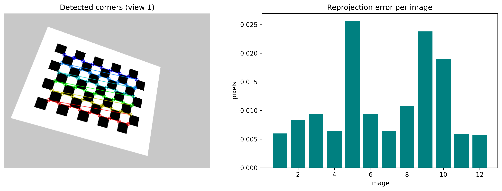

# Experiment 8: Camera Calibration

> **File:** `exp8.py`  |  **Tools:** Python 3.13, OpenCV (cv2), NumPy and Matplotlib, MacOS

## 🎯 Aim

Implement camera calibration using a chessboard pattern.

## 📘 Theory

Camera calibration estimates the intrinsic parameters of a camera (focal lengths and principal point, collected in the matrix K) and its lens distortion coefficients. It also gives the rotation R and translation t of the camera for each picture. These are needed to correct lens distortion and to measure real-world sizes from images. The pinhole camera model relates a 3-D point to its pixel position as:

- **Intrinsic matrix (K)**: focal lengths fx, fy and the principal point (cx, cy).
- **Distortion coefficients**: describe the bending of straight lines caused by the lens.
- **Extrinsic parameters (R, t)**: position and orientation of the camera for every image.
- **Reprojection error**: pixel distance between the detected corners and the corners re-projected with the estimated parameters.

### 📐 Formulas

$$ s \tilde{m} = K \left[R | t\right] \tilde{M} $$

$$ K = \left({f}_{x}, {f}_{y}, {c}_{x}, {c}_{y}\right) $$

## 🪜 Algorithm / Steps

1. Create a 9 × 6 chessboard image and render it from 12 different viewpoints using a camera of known matrix.
2. Detect the inner corners in every image with cv2.findChessboardCorners() and refine them with cornerSubPix().
3. Pair the 2-D corners with the known 3-D board points.
4. Call cv2.calibrateCamera() and print K and the distortion coefficients.
5. Calculate the reprojection error of every image and display the detected corners and error chart.

## 💻 Code

```python
import cv2
import numpy as np
import matplotlib.pyplot as plt

cols, rows, sq = 9, 6, 40
board = np.full(((rows + 1) * sq, (cols + 1) * sq), 255, np.uint8)
for r in range(rows + 1):
    for c in range(cols + 1):
        if (r + c) % 2 == 0:
            board[r*sq:(r+1)*sq, c*sq:(c+1)*sq] = 0
board = cv2.copyMakeBorder(board, 60, 60, 60, 60,
                           cv2.BORDER_CONSTANT, value=255)

W, H = 640, 480
K_true = np.array([[700, 0, 320], [0, 700, 240], [0, 0, 1]], np.float64)
rng = np.random.default_rng(3)

obj_pts, img_pts, views = [], [], []
objp = np.zeros((rows * cols, 3), np.float32)
objp[:, :2] = np.mgrid[0:cols, 0:rows].T.reshape(-1, 2) * sq
crit = (cv2.TERM_CRITERIA_EPS + cv2.TERM_CRITERIA_MAX_ITER, 30, 0.001)

for i in range(12):
    rvec = rng.uniform(-0.45, 0.45, 3)
    tvec = np.array([-180 + rng.uniform(-40, 40),
                     -120 + rng.uniform(-30, 30),
                     900 + rng.uniform(-100, 150)])
    Rm, _ = cv2.Rodrigues(rvec)
    s0 = 60 + sq
    off = np.array([[1, 0, -s0], [0, 1, -s0], [0, 0, 1]], np.float64)
    Hm = K_true @ np.column_stack([Rm[:, 0], Rm[:, 1], tvec]) @ off
    view = cv2.warpPerspective(board, Hm, (W, H), borderValue=200)
    ok, corners = cv2.findChessboardCorners(view, (cols, rows))
    if ok:
        corners = cv2.cornerSubPix(view, corners, (11, 11), (-1, -1), crit)
        obj_pts.append(objp); img_pts.append(corners); views.append(view)

print(f"Chessboard detected in {len(views)} / 12 images")

rms, K, dist, rvecs, tvecs = cv2.calibrateCamera(
    obj_pts, img_pts, (W, H), None, None)
print("\nRMS reprojection error :", round(rms, 4), "pixels")
print("\nEstimated camera matrix K:")
print(np.round(K, 2))
print("\nTrue camera matrix used for rendering:")
print(K_true)
print("\nDistortion coefficients:", np.round(dist.ravel(), 4))

errs = []
for o, p, r, t in zip(obj_pts, img_pts, rvecs, tvecs):
    proj, _ = cv2.projectPoints(o, r, t, K, dist)
    d = cv2.norm(p.reshape(-1, 2), proj.reshape(-1, 2), cv2.NORM_L2)
    errs.append(d / len(proj))
print("Mean error per image   :", np.round(errs, 3))

vis = cv2.cvtColor(views[0], cv2.COLOR_GRAY2RGB)
cv2.drawChessboardCorners(vis, (cols, rows), img_pts[0], True)
fig, ax = plt.subplots(1, 2, figsize=(12, 4.5))
ax[0].imshow(vis)
ax[0].set_title("Detected corners (view 1)")
ax[0].axis("off")
ax[1].bar(range(1, len(errs) + 1), errs, color="teal")
ax[1].set_title("Reprojection error per image")
ax[1].set_xlabel("image")
ax[1].set_ylabel("pixels")
plt.tight_layout()
plt.show()
```

## 🖥️ Output

```text
Chessboard detected in 12 / 12 images

RMS reprojection error : 0.0981 pixels

Estimated camera matrix K:
[[699.81   0.   320.57]
 [  0.   699.9  240.67]
 [  0.     0.     1.  ]]

True camera matrix used for rendering:
[[700.   0. 320.]
 [  0. 700. 240.]
 [  0.   0.   1.]]

Distortion coefficients: [ 5.90e-03 -7.40e-02  3.00e-04  7.00e-04  3.66e-01]
Mean error per image   : [0.006 0.008 0.009 0.006 0.026 0.009 0.006 0.011 0.024 0.019 0.006 0.006]
```

<p align="center"></p>

## ✅ Result

The chessboard was found in all 12 images. The RMS reprojection error was only 0.098 pixels, and the estimated focal length (about 699.8) and principal point (about 320.6, 240.7) match the true values 700 and (320, 240).

## 🎤 Viva Questions

**Q. What does camera calibration find?**  
A. The intrinsic parameters (focal lengths, principal point and distortion) of a camera.

**Q. What is in the intrinsic matrix K?**  
A. The focal lengths fx and fy and the image centre cx and cy in pixels.

**Q. Why is a chessboard used?**  
A. Its corners are easy to detect with sub-pixel accuracy and the real spacing is known.

**Q. What is the reprojection error?**  
A. The distance in pixels between the detected corners and the corners projected with the estimated parameters.

**Q. What are extrinsic parameters?**  
A. The rotation and translation of the camera relative to the board for each picture.

---
[⬅ Back to index](README.md)
