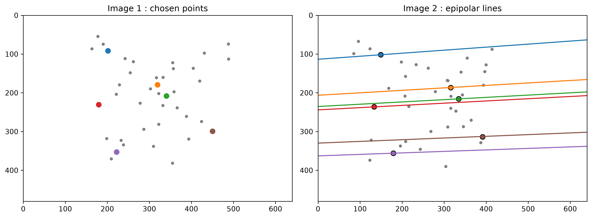

# Experiment 9: Fundamental Matrix

> **File:** `exp9.py`  |  **Tools:** Python 3.13, OpenCV (cv2), NumPy and Matplotlib, MacOS

## 🎯 Aim

Compute the fundamental matrix from point correspondences of two images.

## 📘 Theory

When the same 3-D scene is seen from two camera positions, the fundamental matrix F captures the epipolar geometry between the two images. For a point x in the first image, its matching point x' in the second image must lie on the line F·x, called the epipolar line. This gives the epipolar constraint:

- **Fundamental matrix (F)**: a 3 × 3 matrix of rank 2 that links matching points of two views.
- **Epipolar line**: the line in the second image on which the match of a first-image point must lie.
- **RANSAC**: ignores wrong matches (outliers) while estimating F.
- **Eight-point algorithm**: F can be estimated from at least eight point pairs.

### 📐 Formulas

$$ {x'}^{T} F x = 0, \text{rank}\left(F\right) = 2 $$

## 🪜 Algorithm / Steps

1. Create 40 random 3-D points in front of two cameras (the second one shifted and slightly rotated).
2. Project the points into both images and add a little pixel noise.
3. Estimate F using cv2.findFundamentalMat() with RANSAC.
4. Check the rank of F and the epipolar residual |x'ᵀ F x|.
5. Draw the epipolar lines in the second image for six chosen points.

## 💻 Code

```python
import cv2
import numpy as np
import matplotlib.pyplot as plt

rng = np.random.default_rng(11)

P3 = np.column_stack([rng.uniform(-1, 1, 40),
                      rng.uniform(-1, 1, 40),
                      rng.uniform(4, 8, 40)])
K = np.array([[800, 0, 320], [0, 800, 240], [0, 0, 1]], np.float64)

R2, _ = cv2.Rodrigues(np.array([0.0, 0.12, 0.03]))
t2 = np.array([[-1.0], [0.05], [0.1]])

p1, _ = cv2.projectPoints(P3, np.zeros(3), np.zeros(3), K, None)
p2, _ = cv2.projectPoints(P3, R2, t2, K, None)
p1 = p1.reshape(-1, 2) + rng.normal(0, 0.3, (40, 2))
p2 = p2.reshape(-1, 2) + rng.normal(0, 0.3, (40, 2))

F, mask = cv2.findFundamentalMat(p1, p2, cv2.FM_RANSAC, 1.0, 0.99)
F = F / F[2, 2]
print("Fundamental matrix F:")
np.set_printoptions(precision=6, suppress=True)
print(F)
print("\nRank of F          :", np.linalg.matrix_rank(F, tol=1e-6))
print("det(F)             :", f"{np.linalg.det(F):.2e}")
print("Inliers used       :", int(mask.sum()), "/", len(p1))

h1 = np.column_stack([p1, np.ones(len(p1))])
h2 = np.column_stack([p2, np.ones(len(p2))])
res = np.abs(np.sum(h2 * (h1 @ F.T), axis=1))
print("Mean |x2' F x1|    :", f"{res.mean():.4f}")

pts = p1[:6].reshape(-1, 1, 2)
lines = cv2.computeCorrespondEpilines(pts, 1, F).reshape(-1, 3)
fig, ax = plt.subplots(1, 2, figsize=(12, 4.5))
cols = plt.cm.tab10(np.arange(6))
ax[0].scatter(p1[:, 0], p1[:, 1], s=12, c="gray")
ax[0].scatter(p1[:6, 0], p1[:6, 1], c=cols, s=50)
ax[0].set_xlim(0, 640); ax[0].set_ylim(480, 0)
ax[0].set_title("Image 1 : chosen points")
ax[1].scatter(p2[:, 0], p2[:, 1], s=12, c="gray")
xs = np.array([0, 640])
for (a, b, c), colr, q in zip(lines, cols, p2[:6]):
    ax[1].plot(xs, -(a * xs + c) / b, color=colr)
    ax[1].scatter(*q, color=colr, s=50, edgecolor="k")
ax[1].set_xlim(0, 640); ax[1].set_ylim(480, 0)
ax[1].set_title("Image 2 : epipolar lines")
plt.tight_layout()
plt.show()
```

## 🖥️ Output

```text
Fundamental matrix F:
[[ 0.000001  0.000017 -0.010481]
 [-0.000002 -0.000003 -0.110566]
 [ 0.0091    0.106601  1.      ]]

Rank of F          : 2
det(F)             : -1.66e-22
Inliers used       : 37 / 40
Mean |x2' F x1|    : 0.0343
```

<p align="center"></p>

## ✅ Result

The estimated F has rank 2 (determinant ≈ 1e-22) and 37 of the 40 points were accepted as inliers. The average value of |x'ᵀ F x| was only 0.034, which confirms the epipolar constraint. In the plot, each epipolar line passes through its matching point.

## 🎤 Viva Questions

**Q. What is the fundamental matrix?**  
A. A 3 × 3 matrix that links the matching points of two views of the same scene: x′ᵀFx = 0.

**Q. What is an epipolar line?**  
A. The line in the second image on which the match of a point of the first image must lie.

**Q. What is the rank of F and why?**  
A. Rank 2, so that all epipolar lines meet in one point, the epipole.

**Q. Why are the points normalised in the eight-point algorithm?**  
A. It makes the solution numerically stable.

**Q. How many matches are needed at least?**  
A. Eight for the linear method, because F has eight degrees of freedom up to scale.

---
[⬅ Back to index](README.md)
